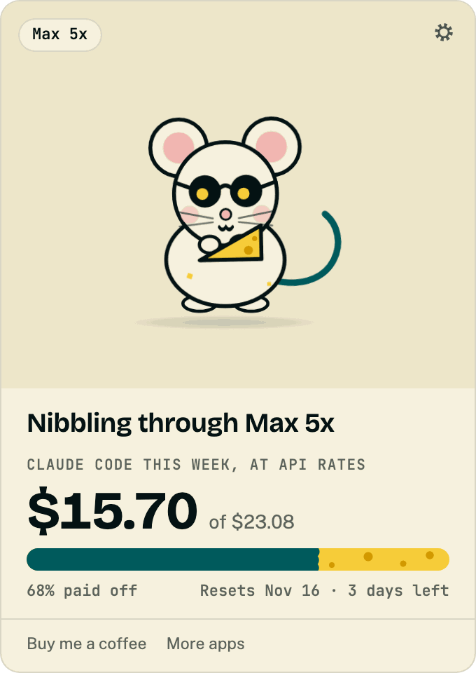
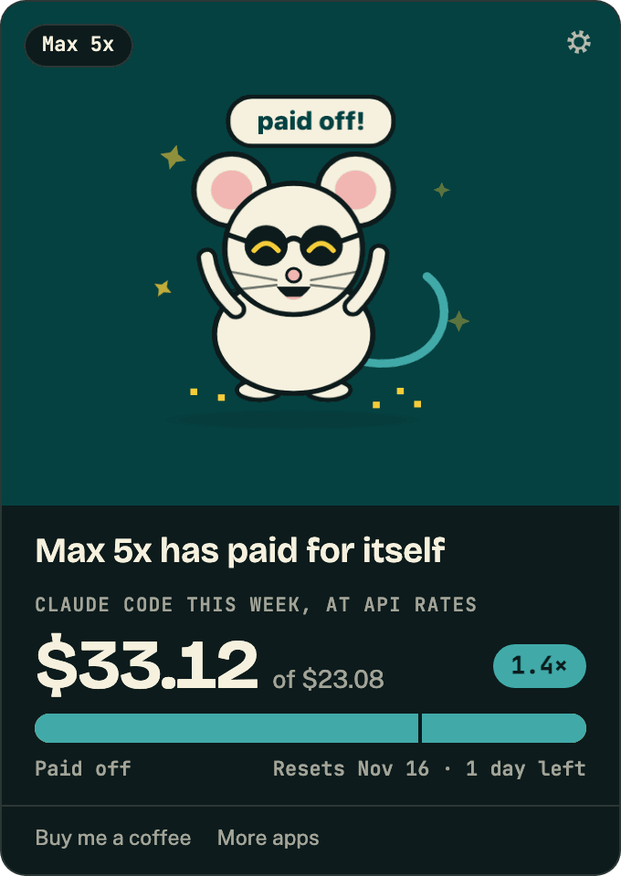
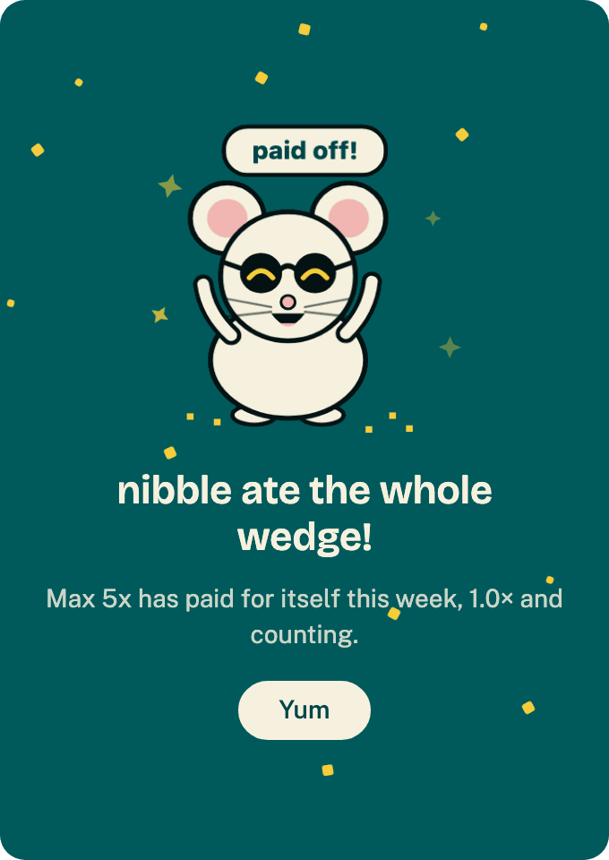
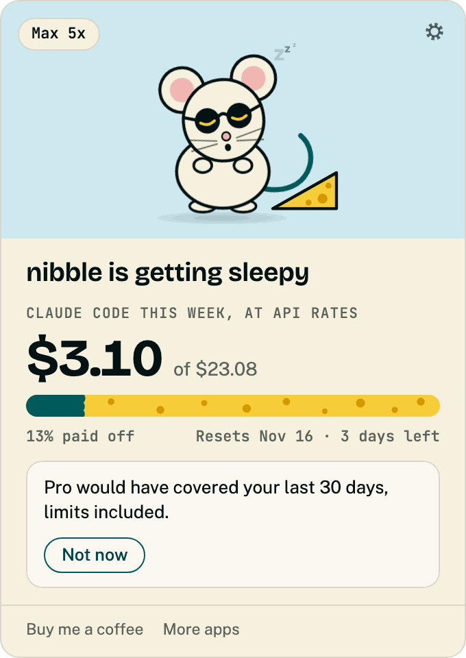
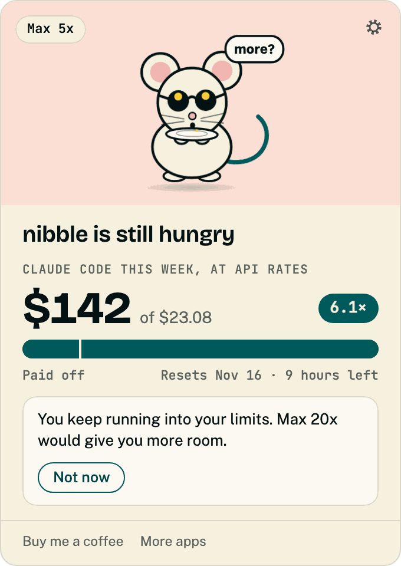
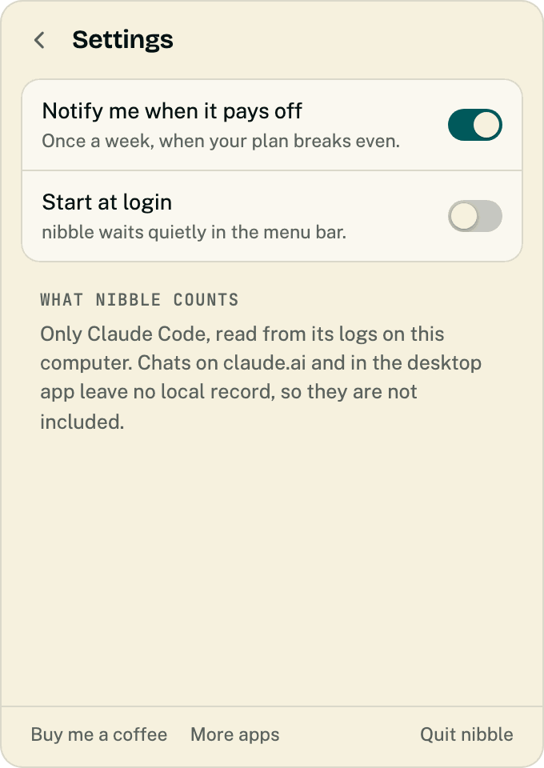

# nibble

A menu bar app that prices your AI usage at API rates and tells you whether your subscription is paying for itself. nibble, a cheese-loving mouse, eats through a wedge as your usage adds up, celebrates when the plan has paid for itself, and suggests a cheaper or bigger plan when that would suit you better.

For now nibble measures Claude Code only, from its local logs. macOS comes first; Windows and Linux are planned.

## Screenshots

<table>
  <tr>
    <td width="33%"></td>
    <td width="33%"></td>
    <td width="33%"></td>
  </tr>
  <tr>
    <td><b>Nibbling.</b> This week's Claude Code usage at API rates, against your plan's weekly share.</td>
    <td><b>Paid off</b> (dark mode). The plan has covered itself, and the multiplier shows by how much.</td>
    <td><b>Break-even.</b> nibble celebrates once the wedge is gone.</td>
  </tr>
  <tr>
    <td></td>
    <td></td>
    <td></td>
  </tr>
  <tr>
    <td><b>Sleepy.</b> Underusing the plan, nibble suggests a cheaper one.</td>
    <td><b>Still hungry.</b> Hitting limits, nibble suggests a bigger plan.</td>
    <td><b>Settings.</b> A break-even notification, start at login, and what nibble counts.</td>
  </tr>
</table>

## Development

```sh
pnpm install
pnpm dev      # run the app
pnpm check    # formatters, lints, tests and licence checks
```

## Support

If nibble is useful to you, you can [buy me a coffee](https://buymeacoffee.com/tonytangdev) ☕

You can find my other apps at [tonytang.dev/apps](https://tonytang.dev/apps/).

## License

GPL-3.0-or-later. See [LICENSE](LICENSE).
